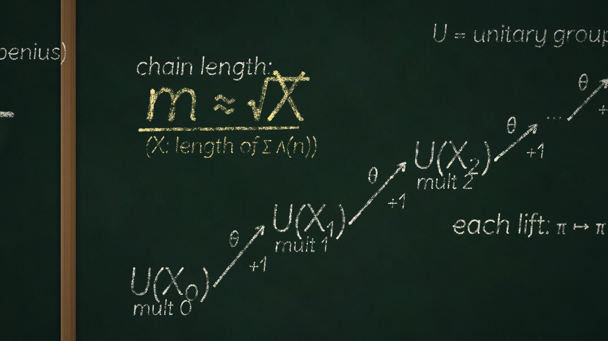

# The Line at One-Half · 实部 1/2 的那条线

一支 MV（3:58，1080p，30 fps）：用一面写满粉笔的黑板墙，把 Levent Alpöge 与 Claude 宣布的黎曼猜想证明的**思路**讲一遍。
歌是 Suno 生成的同名歌曲，字幕逐词跟唱（英文歌词 + 中文译文），画面上的每一笔粉笔都卡在歌词的某个词上。

[](https://github.com/realRoc/the-line-at-one-half/releases/download/v1.0/the-line-at-one-half.mp4)

- 成片（1080p，166 MB，在 Release 里）：[the-line-at-one-half.mp4](https://github.com/realRoc/the-line-at-one-half/releases/download/v1.0/the-line-at-one-half.mp4)
- 字幕文件：[`subtitles_en.srt`](subtitles_en.srt)、[`subtitles_zh.srt`](subtitles_zh.srt)（画面里已经烧录了字幕）
- 分镜与设计：[`TREATMENT.md`](TREATMENT.md)

> **先说清楚状态。** 证明由 Levent Alpöge（和 Claude 合作）于 2026-11-20 宣布，发布形式是约 1740 万行 Lean 代码
> （作者原始发布：[alpo.ge](https://alpo.ge/)，说明文档 [remark.pdf](https://alpo.ge/remark.pdf)；GitHub 镜像：
> [CocoSgt/riemann-hypothesis-lean](https://github.com/CocoSgt/riemann-hypothesis-lean)）。
> 截至镜像时，**还没有公开的独立编译、内核复核或同行审查**。所以这支 MV 讲的是“作者描述的证明路线”，不是“已被确认的定理”。
> 作者在 remark 里也说，除了 Lean 之外他还生成过一份 25 万多页的“书”，但没有发布，因为不可读；发布的只有 Lean 代码。
> 下面的讲解里，高深部分（θ 提升链、跷跷板、岩泽塔等）是转述作者 4 页说明里的提纲，我没有、也无法独立核对每一步。

---

## 七块黑板讲完的故事

整面墙是 7 块黑板，镜头从左走到右，时间就是空间。三种粉笔：**白色**写结构；**橙色**只用来画“那条线”（实部 = 1/2）和落在线上的零点；**淡黄色**是 Claude 的笔迹（√X 那个关键建议，以及 Lean 内核最后报出的三条公理）。

### 0:00 – 0:50　第一块板：1859，“很可能如此”

- ζ(s) = Σ 1/nˢ = Π_p (1 − p⁻ˢ)⁻¹：左边是全体正整数，右边是全体素数（欧拉乘积）。
- 黎曼在 1859 年的论文里写：所有（非平凡）零点很可能都在实部 1/2 的直线上——原文 *sehr wahrscheinlich*（很可能）。
- 为什么重要：零点离这条线越近，素数分布的误差就越小。RH 等价于：素数计数 π(x) 与 Li(x) 的误差不超过 √x·log x 量级。
- 画面：临界带、橙色的临界线、前十个零点（14.13, 21.02, 25.01 …）一个个落在线上。数值上前 10¹³ 个零点都已验证在线上，但这不是证明。

### 0:50 – 1:21　第二块板：有限域里，这已经是定理了

- **韦伊（1948）** 证明了有限域上曲线的“黎曼猜想”：#C(𝔽_q) = q + 1 − Σαᵢ，且每个 |αᵢ| = √q。
- **斯捷潘诺夫（1969）** 给了一条初等的路：造一个辅助函数 f，让它在曲线上每个 𝔽_q-点都**以 m 重**为零。
  f 的次数有限，零点（按重数算）却很多，两相比较就压出 #C(𝔽_q) ≤ q + O(√q)。粉笔画里每个点外面一圈圈的环就是“重数”。
- 关键在于：在特征 p 里，Frobenius（x ↦ x^q）让“高重数”几乎是白送的。

### 1:11 – 1:21　同一块板右半边：可是整数不给你这个

- 整数上没有 Frobenius，也没有“对整数求导”这种事——板上写着 `mult. = d/dn ?`，然后被**唯一的一次擦黑板**擦掉，原地写上 **BUILD IT**：
  既然世界不给你重数，那就自己造。

### 1:22 – 1:43　第三块板（副歌）：θ 提升链

- 作者的核心想法（remark 第 8 条）：在全定（totally definite）酉群之间做**一串 θ 提升**
  U(X₀) → U(X₁) → … → U(Xₘ)，每一步 π ↦ π ⊞ μⱼ，**每提升一次，就赢得一层“重数”**——这正是斯捷潘诺夫论证在整数世界里的替身。
- 链要多长？对长度为 X 的 von Mangoldt 和 Σ Λ(n)，Claude 提出链长取 **√X**（淡黄色）。作者原话大意：“还能是别的吗？”
- 副歌结尾三声 “to the line”，三个零点落回橙色的线。

### 1:47 – 2:07　第四块板：跷跷板与岩泽塔

- **Rallis 跷跷板**（seesaw duality）：(θf, g) = (f, θg)，两边相等；作者用它说明迭代提升的周期等于一个 **Bessel 周期**，
  而且**与 Hecke 特征标无关**——板上的 χ₁, χ₂, χ₃ 被一一划掉。
- **岩泽塔** K₀ ⊂ K₁ ⊂ K₂ ⊂ … ⊂ K_∞：作者说这是在模仿有限域里的 𝔽_q ⊂ 𝔽_{q²} ⊂ 𝔽_{q³} ⊂ …（对扩张做鸽笼）。

### 2:07 – 2:27　第五块板左边：显式公式与正性

- **显式公式**：Σ Λ(n)φ(n) = 主项 − Σ_ρ φ̂(ρ)，左边是素数，右边是零点——“素数和零点在显式公式里两清”。
- **韦伊正性判据**：RH ⇔ 一个二次型 W(f) 对所有 f 非负（一个方差、一个平方和）。作者通过一个行列式拿到这个正号。
- **不用高斯和**：原本需要高斯和的抵消，作者换成**迭代 k 次 Parseval**，得到 qN = Mᵏ + R，且余项 R 是平方根量级（“square-root cancellation”）。

### 2:28 – 2:38　第五块板右边（桥段）：每次提升的代价

- 作者精确计算了每次提升的“代价”：先验地，只能走到 **2/3** 就停下（图上平台）。
- 用 **twist（扭曲）** 赶走剩下的障碍；扭不掉的那一类，靠**一个减弱版的 Vandiver 猜想**处理，涉及 ℤ 的 K 群。

### 2:39 – 2:59　回到第三块板（第二遍副歌）：缝合

- 链上每一步标上 +1（每一步赢一层重数），√X 下划线，补一句 “X 是 Σ Λ(n) 的长度”。
- 一条橙色的线从链尽头那条线出发，沿黑板底部一路缝回第一块板黎曼的那条线；共轭零点 1/2 − 14.13i … 依次落下。
- 拉远：整面墙一次看全。

### 3:01 – 3:43　第六块板：Lean

- 175,187 个文件，约 1740 万行 Lean 4 + Mathlib。静态扫描：`sorry` 0 个，新 `axiom` 0 个。
- `theorem riemannHypothesis : RiemannHypothesis := rhOfAll`——目标命题用的是 **Mathlib 自己的定义**，不是仓库自定义的。
- 还差的是：完整编译跑完、`#print axioms riemannHypothesis` 读出来**只剩** `propext`、`Classical.choice`、`Quot.sound` 三个 Lean 标准公理（淡黄色），以及用 lean4checker 之类做独立内核复核。歌词 “the build's not done” 说的就是这个。
- 最后一笔：一条完整的橙色线。

### 3:43 – 3:58　片尾

标题、作者、出处，以及“尚无公开的独立编译与审查”的说明。

---

## 怎么做的

- 风格：[Lemo-Opuscar](https://github.com/lemomo-ai/lemo-opuscar) 库里的 **Chalkboard（黑板粉笔）**。整片是代码画出来的：
  每一笔是一条中心线，烘焙成粉笔覆盖率贴图，按笔顺、按时间逐笔显现；没有图片、没有 AI 生成画面。
- 板书：英文用单线手写字体 EMS Delight；字体里没有的希腊字母和数学符号（ζ θ Λ Σ Π √ → ≥ ℤ 𝔽 ⊞ …）是在 `js/mathhand.js` 里手写的笔画数据。
- 音画同步：先用 demucs 分离人声，再用 stable-ts（faster-whisper large-v3-turbo）把歌词**强制对齐**到人声，拿到每个词的起始时间（`data/lyrics_aligned.json`，做法见 `tools/align.md`）。
  `js/film.js` 里每一笔都写成 `at('词')`——比如 “Build it” 的 “Build” 一出声，BUILD IT 正好写完。字幕的英文逐词点亮。
- 声音：歌曲原样不动；下面垫了很轻的真实粉笔录音（CC0），每一笔一段，比歌低约 24 dB。

```
LIB=~/lemo-opuscar sh build.sh
```

需要 Lemo-Opuscar 库（`setup.sh deps` 装好 Node、无头浏览器、Python 环境）和 ffmpeg 7+。字体和粉笔录音由脚本自动下载。

文件：`index.html` → `js/app.js`（合成：墙、黑板、粉笔、擦除、光、字幕）→ `js/film.js`（每一笔、镜头、字幕，都是数据）。
`js/chalk.js`、`js/hand.js`、`js/r2d.js`、`js/post.js`、`js/props.js` 来自 Lemo-Opuscar 的 Chalkboard 引擎。

## 版权与致谢

见 [`CREDITS`](CREDITS)。数学与 Lean 代码属于 Levent Alpöge（与 Claude）；本仓库只是一支讲解 MV，不含也不修改证明代码。
